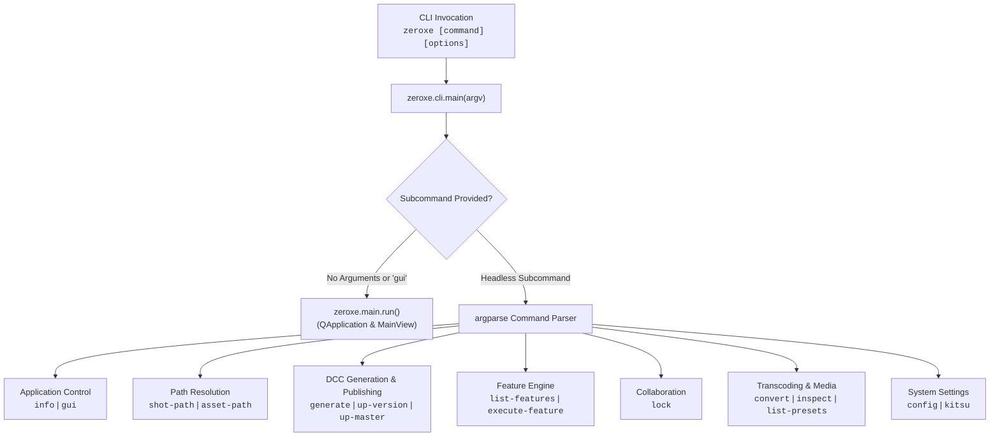

# ZeroXe CLI Reference Manual

This document provides technical reference and operational guidelines for the **ZeroXe Command Line Interface (CLI)** (`src/zeroxe/cli.py`).

---

## 1. Architecture & Execution Modes

**ZeroXe** operates as a hybrid desktop application and command-line tool. It serves artists through an interactive **PySide6 (Qt 6)** graphical interface, while providing Technical Directors (TDs), render wranglers, and automated pipelines with full headless terminal control.

When launched without arguments (or with `gui` / `--gui`), ZeroXe initializes the Qt event loop and opens the main desktop window. When invoked with operational subcommands, ZeroXe executes strictly in **headless mode** without instantiating GUI widgets or requiring an active display server (X11/Wayland).



---

## 2. Invocation Methods

ZeroXe supports four invocation methods across development environments, containerized workers, and studio workstations:

### 2.1. Installed CLI (`zeroxe`)
Available globally when the virtual environment is active:
```bash
zeroxe --version
zeroxe [command] [options...]
```

### 2.2. Python Module (`python -m zeroxe`)
Standard module execution:
```bash
python -m zeroxe --help
python -m zeroxe [command] [options...]
```

### 2.3. Python Script (`python -m zeroxe.main`)
Legacy/direct script execution:
```bash
python -m zeroxe.main [command] [options...]
```

### 2.4. Standalone Binary / AppImage
PyInstaller standalone directory or AppImage bundle:
```bash
./dist/zeroxe/zeroxe --version
./dist/zeroxe/zeroxe info
./dist/zeroxe/zeroxe shot-path -d Layout -e ep998 -s sq01 --sh sh0020
```

---

## 3. Global Flags

| Flag | Shorthand | Description |
| :--- | :--- | :--- |
| `--help` | `-h` | Display usage syntax and available subcommands. |
| `--version` | `-v`, `-V` | Output version string (`Zeroxe YY.MM.DD`) and exit. |
| `--gui` | | Force interactive GUI launch. |

---

## 4. Command Reference

### 4.1. Application Control

#### `gui`
Launches the interactive Qt desktop GUI application.

```bash
# Launch GUI normally
zeroxe gui

# Launch GUI and preload a specific project
zeroxe gui --project "Melangkah Dari Timur"
```

#### `info`
Queries runtime diagnostics, build metadata, platform paths, and service configurations.

```bash
# Formatted summary
zeroxe info

# Machine-readable JSON output
zeroxe info --json
```

**JSON Output Schema**:
```json
{
  "app_name": "Zeroxe",
  "version": "26.10.23",
  "organization": "ZeroxeOrg",
  "maintainer": "iYapi",
  "website": "https://yapi.expiproject.com",
  "python_version": "3.14.8",
  "python_executable": "/path/to/.venv/bin/python",
  "platform": "linux",
  "base_dir": "/path/to/ZeroXe",
  "user_data_dir": "/home/user/.local/share/zeroxe",
  "scripts_dir": "/home/user/.local/share/zeroxe/scripts",
  "assets_dir": "/path/to/ZeroXe/assets",
  "zeroxe_map_path": "/mnt/I/zeroxe_map.yaml",
  "active_blender": "/usr/bin/blender",
  "pureref_path": "",
  "ffmpeg_executable": "/usr/bin/ffmpeg",
  "kitsu_url": "http://192.168.99.38:8080",
  "kitsu_configured": true,
  "kitsu_connected": false
}
```

---

### 4.2. Pipeline Path Resolution

#### `shot-path`
Resolves production master and version paths for shots based on department, episode, sequence, and shot codes.

```bash
zeroxe shot-path -d <department> -e <episode> -s <sequence> --sh <shot> [options]
```

**Parameters**:
- `--dept`, `-d` *(required)*: Department code or name (e.g. `Layout`, `lay`, `Animation`, `anm`).
- `--ep`, `-e` *(required)*: Episode code (e.g. `ep998`).
- `--sq`, `-s` *(required)*: Sequence code (e.g. `sq01`).
- `--sh` *(required)*: Shot code (e.g. `sh0020`).
- `--ver`, `-v`: Target version number (default: `1`).
- `--ver-folder`: Version directory name (default: `progress`).
- `--mount`: Override project storage root mount path.
- `--config`, `-c`: Custom `pipeline.yaml` path.
- `--project`, `-p`: Project name (from `zeroxe_map.yaml`).
- `--list-versions`: List existing versions found on disk.
- `--next-version`: Calculate next available version path.
- `--json`: Output as JSON.

**Example**:
```bash
zeroxe shot-path -d Layout -e ep998 -s sq01 --sh sh0020 --json
```

**JSON Response**:
```json
{
  "success": true,
  "master_path": "/mnt/I/.../02_layout/ep998/ep998_sq01/ep998_sq01_sh0020/mdt_ep998_sq01_sh0020_lay.blend",
  "version_path": "/mnt/I/.../02_layout/ep998/ep998_sq01/ep998_sq01_sh0020/progress/mdt_ep998_sq01_sh0020_lay_v001.blend",
  "shot_dir": "/mnt/I/.../02_layout/ep998/ep998_sq01/ep998_sq01_sh0020",
  "version_dir": "/mnt/I/.../02_layout/ep998/ep998_sq01/ep998_sq01_sh0020/progress",
  "file_name": "mdt_ep998_sq01_sh0020_lay.blend",
  "version_file_name": "mdt_ep998_sq01_sh0020_lay_v001.blend",
  "version_number": 1
}
```

#### `asset-path`
Resolves production master and version paths for 3D/2D assets.

```bash
zeroxe asset-path -t <type> -n <name> [-d <department>] [options]
```

**Parameters**:
- `--type`, `-t` *(required)*: Asset type code (e.g. `CHAR`, `PROPS`, `SET`, `VEHICLE`).
- `--name`, `-n` *(required)*: Asset name (e.g. `Hero_Char`, `c-hero`).
- `--dept`, `-d`: Department/task name (e.g. `Model`, `Texture`).
- `--ver`, `-v`: Target version number (default: `1`).
- `--ver-folder`: Version directory name (default: `progress`).
- `--mount`: Override storage root mount.
- `--config`, `-c`: Custom `pipeline.yaml` path.
- `--project`, `-p`: Project name.
- `--list-versions`: List existing versions on disk.
- `--next-version`: Calculate next available version path.
- `--json`: Output as JSON.

---

### 4.3. DCC Scene Generation & Versioning

#### `generate`
Executes division builders (Layout, Animation, Lighting, Compositing, Editing) to construct scene files.

```bash
zeroxe generate -f <target_file> -d <department> [options]
```

**Parameters**:
- `--file`, `-f` *(required)*: Target shot DCC file path or version file path.
- `--dept`, `-d`: Department name (default: `Layout`).
- `--mode`, `-m`: Builder mode (`previous` or `scan`).
- `--shot-data`: JSON string of shot metadata (`frame_in`, `frame_out`, `fps`, `resolution`).
- `--fg-yaml`: Foreground asset mapping YAML (for Lighting).
- `--master-shot`: Mastershot sibling name (for Compositing).
- `--master-file`: Custom template blend file (for Compositing).
- `--run`, `--execute`: Execute generated script in headless Blender immediately.
- `--blender`: Blender executable path override.
- `--config`, `-c`: Custom `pipeline.yaml` path.
- `--json`: Output as JSON.

**Example**:
```bash
zeroxe generate \
  -f "/mnt/I/.../mdt_ep998_sq01_sh0020_lay.blend" \
  -d Layout \
  --shot-data '{"data":{"frame_in":1,"frame_out":120,"fps":24}}' \
  --run \
  --json
```

#### `up-version`
Increments the version of an existing DCC file and copies it into the version directory.

```bash
zeroxe up-version -f <dcc_file> [--run] [--json]
```

#### `up-master`
Publishes a progress version file back to the master file, embedding preset scripts (e.g. animation baking).

```bash
zeroxe up-master -f <version_file> [--preset <path>] [--run] [--json]
```

---

### 4.4. Feature Registry & Execution

#### `list-features`
Lists all available pipeline features dynamically registered via `@register_feature`.

```bash
zeroxe list-features [-d <department>] [--json]
```

**JSON Response**:
```json
{
  "features": [
    "Generate",
    "Sync",
    "Up Version",
    "Up Master",
    "Playblast Collect"
  ]
}
```

#### `execute-feature`
Dynamically dispatches and executes a registered pipeline feature.

```bash
zeroxe execute-feature -n <feature_name> -f <file_path> [-d <department>] [options]
```

---

### 4.5. Cooperative File Locking

#### `lock`
Controls artist checkout locks and version audit logs in `00_pipeline/locks/`.

```bash
zeroxe lock -k <entity_key> [--check | --acquire | --release | --force | --history] [options]
```

**Parameters**:
- `--key`, `-k` *(required)*: Entity lock key (e.g. `ep998_sq01_sh0010_anm`).
- `--check`: Query current lock status (default).
- `--acquire`: Lock the entity for the current artist.
- `--release`: Unlock the entity upon file close.
- `--force`: Force-break an existing lock.
- `--history`: Retrieve version audit history.
- `--user`, `-u`: Username override.
- `--kitsu-id`: Kitsu user ID override.
- `--project`, `-p`: Project name.
- `--json`: Output as JSON.

**Examples**:
```bash
# Check lock status
zeroxe lock -k ep998_sq01_sh0010_anm --json

# Acquire lock
zeroxe lock -k ep998_sq01_sh0010_anm --acquire --json

# Release lock
zeroxe lock -k ep998_sq01_sh0010_anm --release --json
```

---

### 4.6. Media Transcoding & Inspection

#### `convert`
Transcodes image sequence folders or video files using pipeline presets.

```bash
zeroxe convert -i <input_path> [-p <preset>] [-o <output_file>] [options]
```

**Parameters**:
- `--input`, `-i` *(required)*: Input directory or video file.
- `--preset`, `-p`: Preset identifier (`folder_to_mp4`, `video_to_mp4`; auto-detected if omitted).
- `--output`, `-o`: Target output filename (auto-generated if omitted).
- `--framerate`, `-r`: Target framerate (default: `24`).
- `--quality`, `-q`: CRF quality factor (default: `15`).
- `--project`, `-p`: Project name for custom pipeline presets.
- `--json`: Output as JSON.

**Example**:
```bash
zeroxe convert -i "/renders/sh0010/" -p folder_to_mp4 -r 24 -q 16 --json
```

#### `list-presets`
Queries all active converter presets discovered in the pipeline and local presets directory.

```bash
zeroxe list-presets [--json]
```

#### `inspect`
Analyzes media paths, frame ranges, image counts, and suggested transcode filenames.

```bash
zeroxe inspect -i <path> [--json]
```

---

### 4.7. Configuration & Tracking

#### `config` (or `settings`)
Reads and writes local application settings without opening the graphical interface.

```bash
# List all settings (passwords masked)
zeroxe config --list
zeroxe config --list --json

# Query specific setting key
zeroxe config --get software/active_blender

# Update setting
zeroxe config --set software/dcc_timeout 900
zeroxe config --set software/active_blender "/usr/bin/blender"
```

> [!NOTE]
> Passwords written via `--set kitsu/password` are automatically encrypted using machine-bound symmetric encryption.

#### `kitsu`
Verifies Kitsu production tracking connectivity, credentials, and project availability.

```bash
# Check connectivity status
zeroxe kitsu --status --json

# Attempt login with configured credentials
zeroxe kitsu --login

# List accessible projects
zeroxe kitsu --projects --json
```

---

## 5. Exit Codes & Automation Integration

All ZeroXe CLI commands return POSIX-compliant exit codes:

- `0`: Success.
- `1`: Operational error (details written to `stderr` or formatted in JSON `{"success": false, "error": "..."}`).
- `2`: Syntax or argument parsing error.

### Production Pipeline Recipe (Bash + `jq`)
```bash
#!/usr/bin/env bash
set -euo pipefail

SHOT_DEPT="Layout"
EP="ep998"
SQ="sq01"
SH="sh0020"

# 1. Resolve shot file path
RESOLVED=$(zeroxe shot-path -d "$SHOT_DEPT" -e "$EP" -s "$SQ" --sh "$SH" --json)
MASTER_PATH=$(echo "$RESOLVED" | jq -r '.master_path')
ENTITY_KEY="${EP}_${SQ}_${SH}_lay"

echo "Processing Shot: $MASTER_PATH"

# 2. Acquire lock
zeroxe lock -k "$ENTITY_KEY" --acquire

# 3. Generate initial scene setup and execute in headless Blender
zeroxe generate -f "$MASTER_PATH" -d "$SHOT_DEPT" --run --json

# 4. Release lock
zeroxe lock -k "$ENTITY_KEY" --release
```
