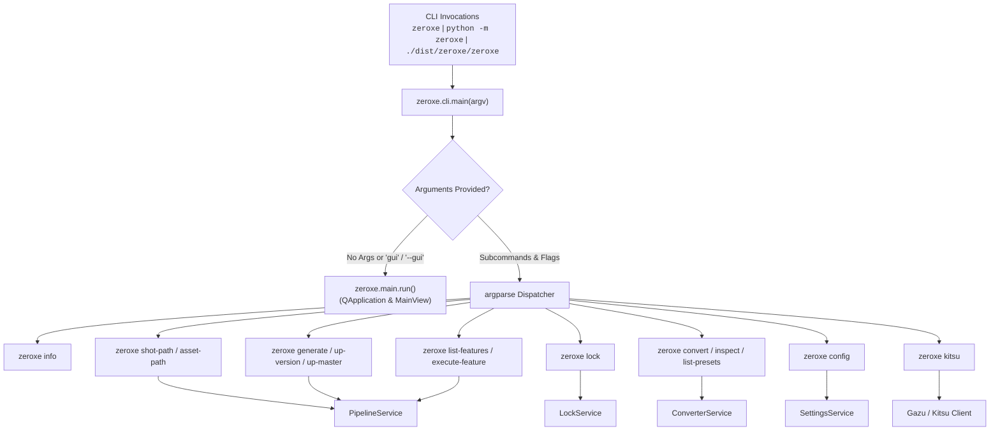

# ZeroXe CLI Architecture & Command Manual

This comprehensive guide covers the architecture, invocation methods, headless execution modes, and full command reference for the **ZeroXe Command Line Interface (CLI)** (`src/zeroxe/cli.py`).

---

## 1. Overview & Architecture

**ZeroXe** is built as a hybrid desktop and CLI application. It provides artists with a rich **PySide6 (Qt 6)** graphical interface, while giving technical directors (TDs), build pipelines, and automated render workflows complete headless terminal control.

When executed without arguments (or with `gui` / `--gui`), ZeroXe initializes the Qt desktop GUI. When invoked with any of its operational subcommands (such as `shot-path`, `convert`, `generate`, `lock`, etc.), it executes in **headless mode** without initializing Qt GUI widgets or requiring an active display server (X11/Wayland).



---

## 2. Invocation Methods

ZeroXe can be invoked in four equivalent ways across development and production environments:

### A. Installed Package CLI (`zeroxe`)
Once installed into your virtual environment (`pip install -e .` or `uv sync`), the script is installed directly into your `PATH`:
```bash
zeroxe --version
zeroxe [subcommand] [options...]
```

### B. Python Module (`python -m zeroxe`)
Runs the package using Python module execution:
```bash
python -m zeroxe --help
python -m zeroxe [subcommand] [options...]
```

### C. Direct Script Entrypoint (`python -m zeroxe.main`)
Preserves backwards compatibility with legacy launcher scripts:
```bash
python -m zeroxe.main [subcommand] [options...]
```

### D. Standalone PyInstaller Binary / AppImage
When compiled using `python scripts/build_executable.py` or `./scripts/build_appimage_docker.sh`, the binary acts as both the graphical application (when launched from the desktop environment) and the CLI tool (when invoked in the terminal):
```bash
./dist/zeroxe/zeroxe --version
./dist/zeroxe/zeroxe info
./dist/zeroxe/zeroxe shot-path -d Layout -e ep998 -s sq01 --sh sh0020
```

---

## 3. Global Options & Flags

| Flag | Short | Description |
| :--- | :--- | :--- |
| `--help` | `-h` | Display help message and list of subcommands. |
| `--version` | `-v`, `-V` | Output version string (`Zeroxe YY.MM.DD`) and exit. |
| `--gui` | | Force GUI mode launch regardless of other flags. |

---

## 4. Subcommand Reference

### 4.1. `gui`
Explicitly launches the PySide6 Qt GUI.

```bash
# Launch GUI normally
zeroxe gui

# Launch GUI and preload a specific project
zeroxe gui --project "Melangkah Dari Timur"
```

---

### 4.2. `info`
Prints application diagnostics, build version, paths, and configured environment settings.

```bash
# Formatted text output
zeroxe info

# JSON output
zeroxe info --json
```

**Example JSON Output**:
```json
{
  "app_name": "Zeroxe",
  "version": "26.10.23",
  "organization": "ZeroxeOrg",
  "maintainer": "iYapi",
  "website": "https://yapi.expiproject.com",
  "python_version": "3.14.8",
  "python_executable": "/home/iyapi/Documents/Project/2026/ZeroXe/.venv/bin/python",
  "platform": "linux",
  "base_dir": "/home/iyapi/Documents/Project/2026/ZeroXe",
  "user_data_dir": "/home/iyapi/.local/share/zeroxe",
  "scripts_dir": "/home/iyapi/.local/share/zeroxe/scripts",
  "assets_dir": "/home/iyapi/Documents/Project/2026/ZeroXe/assets",
  "zeroxe_map_path": "/mnt/I/zeroxe_map.yaml",
  "active_blender": "/usr/bin/blender",
  "pureref_path": "",
  "ffmpeg_executable": "/usr/bin/ffmpeg",
  "kitsu_url": "http://192.168.99.38:8080",
  "kitsu_configured": true,
  "kitsu_connected": false
}
```

---

### 4.3. `shot-path`
Resolves production file paths for shots based on department, episode, sequence, and shot code.

```bash
zeroxe shot-path -d <department> -e <episode> -s <sequence> --sh <shot> [options]
```

**Options**:
- `--dept`, `-d`: Department name or code (e.g. `Layout`, `lay`, `Animation`, `anm`, `Lighting`, `lit`).
- `--ep`, `-e`: Episode code (e.g. `ep998`).
- `--sq`, `-s`: Sequence code (e.g. `sq01`).
- `--sh`: Shot code (e.g. `sh0020`).
- `--ver`, `-v`: Target version number (default: `1`).
- `--ver-folder`: Version directory name (default: `progress`).
- `--mount`: Override project root mount path.
- `--config`, `-c`: Path to custom `pipeline.yaml`.
- `--project`, `-p`: Project name (from `zeroxe_map.yaml`).
- `--list-versions`: List all existing versions found on disk.
- `--next-version`: Compute next incremental version path.
- `--json`: Output result as JSON.

**Example**:
```bash
zeroxe shot-path -d Layout -e ep998 -s sq01 --sh sh0020 --json
```

**JSON Output**:
```json
{
  "success": true,
  "master_path": "/mnt/I/20260222_melangkah_dari_timur/02_production/02_layout/ep998/ep998_sq01/ep998_sq01_sh0020/mdt_ep998_sq01_sh0020_lay.blend",
  "version_path": "/mnt/I/20260222_melangkah_dari_timur/02_production/02_layout/ep998/ep998_sq01/ep998_sq01_sh0020/progress/mdt_ep998_sq01_sh0020_lay_v001.blend",
  "shot_dir": "/mnt/I/20260222_melangkah_dari_timur/02_production/02_layout/ep998/ep998_sq01/ep998_sq01_sh0020",
  "version_dir": "/mnt/I/20260222_melangkah_dari_timur/02_production/02_layout/ep998/ep998_sq01/ep998_sq01_sh0020/progress",
  "file_name": "mdt_ep998_sq01_sh0020_lay.blend",
  "version_file_name": "mdt_ep998_sq01_sh0020_lay_v001.blend",
  "version_number": 1
}
```

---

### 4.4. `asset-path`
Resolves production master and version paths for 3D/2D assets.

```bash
zeroxe asset-path -t <type> -n <name> [-d <department>] [options]
```

**Options**:
- `--type`, `-t`: Asset type (e.g. `CHAR`, `PROPS`, `SET`, `VEHICLE`).
- `--name`, `-n`: Asset name (e.g. `Hero_Char`, `c-hero`).
- `--dept`, `-d`: Department/task name (e.g. `Model`, `Texture`).
- `--ver`, `-v`: Version number (default: `1`).
- `--ver-folder`: Version folder name (default: `progress`).
- `--mount`: Override mount root.
- `--config`, `-c`: Custom `pipeline.yaml` path.
- `--list-versions`: List existing versions on disk.
- `--next-version`: Compute next available version path.
- `--json`: Output result as JSON.

**Example**:
```bash
zeroxe asset-path -t CHAR -n Hero_Char -d Model --json
```

---

### 4.5. `generate`
Generates the initial DCC scene file using the division builder (Layout, Animation, Lighting, Compositing, Editing, etc.).

```bash
zeroxe generate -f <dcc_file> -d <department> [options]
```

**Options**:
- `--file`, `-f`: Target shot DCC file path or version file path.
- `--dept`, `-d`: Department name (e.g. `Layout`, `Animation`, `Lighting`).
- `--mode`, `-m`: Builder resolution mode (`previous` or `scan`).
- `--shot-data`: JSON string of shot metadata (e.g. `'{"data":{"frame_in":101,"frame_out":184,"fps":24}}'`).
- `--fg-yaml`: Foreground assets mapping YAML file (for Lighting).
- `--master-shot`: Mastershot sibling name (for Compositing).
- `--master-file`: Custom `.blend` template path (for Compositing).
- `--run`, `--execute`: Execute the generated script in background headless Blender immediately.
- `--blender`: Path to Blender executable (defaults to configured active Blender).
- `--config`, `-c`: Custom `pipeline.yaml` path.
- `--json`: Output result as JSON.

**Example**:
```bash
zeroxe generate \
  -f "/mnt/I/.../mdt_ep998_sq01_sh0020_lay.blend" \
  -d Layout \
  --shot-data '{"data":{"frame_in":1,"frame_out":120,"fps":24}}' \
  --run \
  --json
```

---

### 4.6. `up-version`
Increments the version of a DCC scene file, copying it into the version directory (`progress/`).

```bash
zeroxe up-version -f <dcc_file> [--run] [--json]
```

**Options**:
- `--file`, `-f`: Input DCC file path.
- `--run`, `--execute`: Execute save in headless Blender immediately.
- `--blender`: Custom Blender executable path.
- `--json`: Output result as JSON.

**Example**:
```bash
zeroxe up-version -f "/mnt/I/.../mdt_ep998_sq01_sh0020_anm.blend" --json
```

---

### 4.7. `up-master`
Publishes a work-in-progress version file back to the master file, embedding optional preset scripts (such as animation baking or cleanup).

```bash
zeroxe up-master -f <dcc_version_file> [--preset <path>] [--run] [--json]
```

**Options**:
- `--file`, `-f`: Input version DCC file path.
- `--preset`: Optional preset Python script to embed before master save.
- `--run`, `--execute`: Execute in headless Blender immediately.
- `--json`: Output result as JSON.

**Example**:
```bash
zeroxe up-master -f "/mnt/I/.../progress/mdt_ep998_sq01_sh0020_anm_v003.blend" --run
```

---

### 4.8. `list-features`
Lists all available pipeline features registered dynamically for a given department.

```bash
zeroxe list-features [-d <department>] [--json]
```

**Example**:
```bash
zeroxe list-features -d Animation --json
```

**JSON Output**:
```json
{
  "features": [
    "Generate",
    "Sync",
    "Up Version",
    "Up Master",
    "Playblast Collect"
  ]
}
```

---

### 4.9. `execute-feature`
Executes any registered pipeline feature dynamically.

```bash
zeroxe execute-feature -n <feature_name> -f <file_path> [-d <department>] [options]
```

**Options**:
- `--name`, `-n`: Registered feature name (e.g. `Up Version`, `Up Master`, `Sync`).
- `--file`, `-f`: Input DCC file path.
- `--dept`, `-d`: Department name.
- `--preset`: Path to preset script.
- `--fg-yaml`: Path to Lighting FG mapping YAML.
- `--master-shot`: Sibling shot name for mastershot template.
- `--run`: Execute script in Blender if feature requires DCC.
- `--json`: Output result as JSON.

---

### 4.10. `lock`
Checks, acquires, or releases cooperative entity file locks.

```bash
zeroxe lock -k <entity_key> [--check | --acquire | --release | --force | --history] [options]
```

**Options**:
- `--key`, `-k`: Entity lock key (e.g. `ep998_sq01_sh0010_anm`).
- `--check`: Check current lock status (default behavior).
- `--acquire`: Acquire lock on the entity.
- `--release`: Release active lock.
- `--force`: Force break/unlock an active lock.
- `--history`: Retrieve version audit trail.
- `--project`, `-p`: Project name.
- `--json`: Output result as JSON.

**Example**:
```bash
# Check lock status
zeroxe lock -k ep998_sq01_sh0010_anm --json

# Acquire lock
zeroxe lock -k ep998_sq01_sh0010_anm --acquire --json

# Release lock
zeroxe lock -k ep998_sq01_sh0010_anm --release --json
```

**JSON Check Output**:
```json
{
  "key": "ep998_sq01_sh0010_anm",
  "is_locked": false,
  "is_locked_by_me": false,
  "locked_by": "",
  "locked_by_id": "",
  "timestamp": "",
  "lock_info": null
}
```

---

### 4.11. `convert`
Transcodes image sequence folders or video files using pipeline presets.

```bash
zeroxe convert -i <input_path> [-p <preset>] [-o <output_file>] [options]
```

**Options**:
- `--input`, `-i`: Input directory (image sequence) or video file.
- `--preset`, `-p`: Preset ID (e.g. `folder_to_mp4`, `video_to_mp4`; auto-detected if omitted).
- `--output`, `-o`: Destination output file path (auto-generated if omitted).
- `--framerate`, `-r`: Framerate (default: `24`).
- `--quality`, `-q`: CRF quality factor (default: `15`).
- `--project`, `-p`: Project name for project-specific presets.
- `--json`: Output result as JSON.

**Example**:
```bash
zeroxe convert -i "/renders/ep998_sq01_sh0010_lay/" -p folder_to_mp4 --framerate 24 --quality 16 --json
```

---

### 4.12. `list-presets`
Lists all available converter presets discovered in the pipeline.

```bash
zeroxe list-presets [--json]
```

**JSON Output**:
```json
{
  "presets": [
    {
      "id": "folder_to_mp4",
      "name": "Folder (Image Sequence) to MP4",
      "input_type": "folder",
      "default_framerate": 24,
      "default_quality": 15,
      "output_extension": ".mp4"
    },
    {
      "id": "video_to_mp4",
      "name": "Video to MP4",
      "input_type": "video",
      "default_framerate": 24,
      "default_quality": 15,
      "output_extension": ".mp4"
    }
  ]
}
```

---

### 4.13. `inspect`
Inspects an image sequence directory or video file, analyzing frame ranges, file counts, and suggested output names.

```bash
zeroxe inspect -i <file_or_folder> [--json]
```

**Example**:
```bash
zeroxe inspect -i "/renders/sh0010/" --json
```

**JSON Output**:
```json
{
  "is_valid": true,
  "type": "folder",
  "name": "sh0010",
  "version": "_v001",
  "file_count": 120,
  "count_display": "120 images (101 - 220)",
  "suggested_output_name": "sh0010_v001"
}
```

---

### 4.14. `config` (or `settings`)
Inspects or modifies ZeroXe settings directly without opening the GUI.

```bash
# List all settings
zeroxe config --list
zeroxe config --list --json

# Get a specific setting
zeroxe config --get software/active_blender

# Set a setting
zeroxe config --set software/dcc_timeout 900
zeroxe config --set software/active_blender "/usr/bin/blender"
```

> [!NOTE]
> Passwords set via `--set kitsu/password` are automatically encrypted using machine-bound symmetric encryption before storage.

---

### 4.15. `kitsu`
Inspects Kitsu production tracking connectivity and lists accessible projects.

```bash
# Check connectivity status
zeroxe kitsu --status --json

# Attempt login with configured credentials
zeroxe kitsu --login

# List accessible projects
zeroxe kitsu --projects --json
```

---

## 5. Exit Codes & Automation Integration

All ZeroXe CLI commands return standardized exit codes suitable for shell scripts, Makefile targets, and CI/CD pipelines:

- `0`: Execution succeeded.
- `1`: Operational or execution error (failure reason printed to `stderr` or included in JSON response `{"success": false, "error": "..."}`).
- `2`: Command-line syntax or argument validation error (generated by `argparse`).

### Bash / Shell Scripting Recipe
```bash
#!/usr/bin/env bash
set -e

# Resolve shot path and extract master path using jq
SHOT_JSON=$(zeroxe shot-path -d Layout -e ep998 -s sq01 --sh sh0020 --json)
MASTER_PATH=$(echo "$SHOT_JSON" | jq -r '.master_path')

echo "Resolved Master Path: $MASTER_PATH"

# Acquire lock before batch task
zeroxe lock -k ep998_sq01_sh0020_lay --acquire

# Run task...

# Release lock upon completion
zeroxe lock -k ep998_sq01_sh0020_lay --release
```
