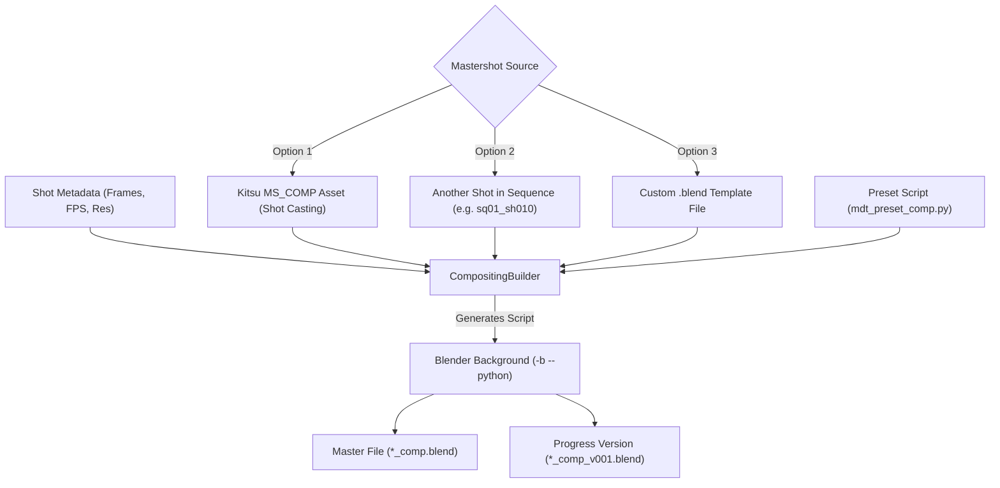
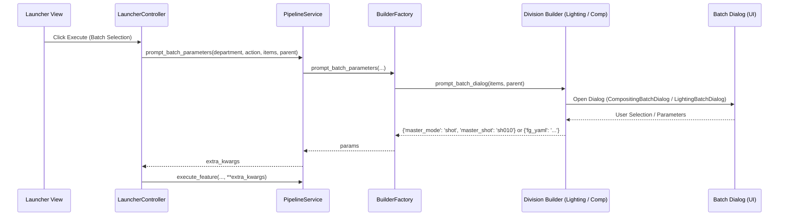

# ZeroXe Compositing Builder & Mastershot Selection Guide

This guide explains the architecture, mastershot resolution logic, and interactive/batch generation workflows of the **Compositing Builder** (`pipeline/Commands/Builders/compositing_builder.py`) and the decoupled pipeline batch prompt system in **ZeroXe**.

---

## 1. Overview & Architecture

When generating a Compositing scene file (`*_comp.blend`), the Compositing Builder:
1. Opens a mastershot template `.blend` file containing compositing node networks, color correction, glow/bloom nodes, render layer setups, and file output nodes.
2. Updates scene frame ranges (`frame_start`, `frame_end`), frame rate (`fps`), and render dimensions (`resolution_x`, `resolution_y`) from Kitsu shot metadata.
3. Automatically executes compositing preset scripts (such as `pipeline/Presets/mdt_preset_comp.py`) to inject standard node trees.
4. Atomically saves the working version (`progress/*_comp_v001.blend`) and the master working file (`*_comp.blend`).



---

## 2. Mastershot Resolution Modes

Artists can pick between three mastershot template sources:

| Mode | Description | How It Resolves |
| :--- | :--- | :--- |
| **Kitsu `MS_COMP`** | Uses the mastershot asset assigned to the shot's casting in Kitsu. | Discovers `COMP_*` / `ms-comp` asset from shot metadata and locates the preset file (e.g., `/projects/mdt/preset_comp/COMP_sq01/COMP_sq01.blend`). |
| **Select Another Shot** | Uses another shot in the sequence as the hero template. | Resolves the target shot's working file (e.g., `mdt_ep998_sq01_sh010_comp.blend`). |
| **Custom Template** | Uses any arbitrary template `.blend` file on disk. | Uses the user-specified file path. |

---

## 3. Interactive Single-Shot & Batch Workflows

### A. Single Shot Generation (`CompositingDialog`)
When generating a single compositing shot from the UI, `CompositingDialog` pops up allowing artists to choose:
- **Kitsu MS_COMP** (with live status showing whether the file was found on disk).
- **Sibling Shot Dropdown** (populated with other shots in the sequence).
- **Custom File Browser** (with `.blend` file picker).

### B. Batch Generation (`CompositingBatchDialog`)
When multiple shots are selected in the launcher table and the user clicks **Generate**:
- **Per-Shot Kitsu MS_COMP**: Resolves the respective `MS_COMP` asset for each individual shot.
- **Single Master Shot for All**: Applies one hero shot (e.g., `sh010`) as the template for every shot in the batch.
- **Custom Template File for All**: Uses a single `.blend` file for all selected shots.

---

## 4. Decoupled Pipeline Batch Prompt Architecture

To keep UI controllers clean, modular, and maintainable, `LauncherController` does **not** hardcode department-specific prompt dialogs. Instead, it delegates batch confirmation and parameter gathering to `PipelineService.prompt_batch_parameters()`.



### Supported Department Batch Prompts:
1. **Lighting**: Prompts with `LightingBatchDialog` (Default FG vs. Custom YAML FG asset mapping).
2. **Compositing**: Prompts with `CompositingBatchDialog` (Per-Shot Kitsu MS vs. Hero Sibling Shot vs. Custom File).
3. **Other Departments / Actions**: Automatically falls back to standard Qt batch confirmation dialog (`QMessageBox.question`).

---

## 5. CLI Usage Examples

Compositing and Lighting generation can also be executed completely via CLI:

```bash
# Generate comp with explicit mastershot file
python pipeline/Commands/main.py generate \
  --config /projects/mdt/pipeline.yaml \
  --department Compositing \
  --shot sh0020 --sequence sq01 --episode ep998 \
  --master-file /projects/mdt/preset_comp/hero.blend

# Generate comp using sibling shot template
python pipeline/Commands/main.py generate \
  --config /projects/mdt/pipeline.yaml \
  --department Compositing \
  --shot sh0020 --sequence sq01 --episode ep998 \
  --master-shot sq01_sh0010

# Generate lighting with custom FG YAML
python pipeline/Commands/main.py generate \
  --config /projects/mdt/pipeline.yaml \
  --department Lighting \
  --shot sh0020 --sequence sq01 --episode ep998 \
  --fg-yaml /projects/mdt/lighting_fg.yaml
```
