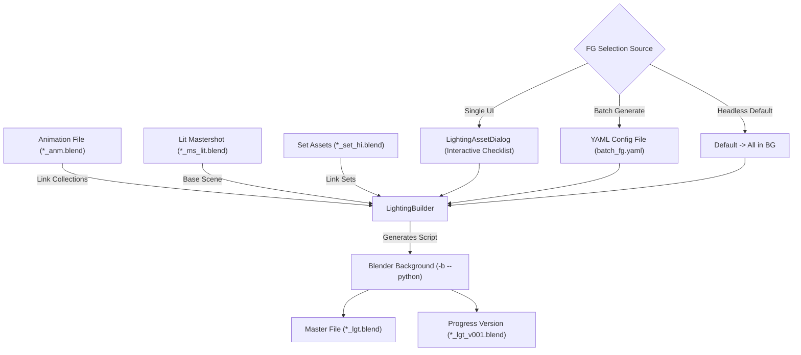

# ZeroXe Lighting Builder & FG Asset Batch Generation Guide

This guide explains the architecture, collection structure, and interactive/batch workflows of the **Lighting Builder** (`pipeline/Commands/Builders/lighting_builder.py`) in **ZeroXe**, including how to configure Foreground (**FG**) and Background (**BG**) assets using YAML files for batch operations.

---

## 1. Overview & Architecture

When generating a Lighting scene file from Animation, the Lighting Builder:
1. Opens the Lit Mastershot file (`LIT_*.blend` or `ms_lit`) as the environment baseline.
2. Dynamically links animated character, prop, and vehicle collections from the source Animation (`*_anm.blend`) file.
3. Automatically classifies assets into **Foreground (`fg`)** and **Background (`bg`)** root collection hierarchies (e.g. `chr_fg`, `chr_bg`, `prp_fg`, `prp_bg`, `vhc_fg`, `vhc_bg`).
4. Links high-resolution environment and set collections under `bg/set`.
5. Links or appends the animated camera (`cam`).
6. Applies render view layer presets (e.g., `pipeline/Presets/mdt_preset_lgt.py`) configuring render passes, AOVs, Cryptomatte, and depth limits.



---

## 2. Generated Blender Scene Collection Hierarchy

The generated scene is organized into clean, standard production collections:

```text
Scene Collection
├── fg
│   ├── chr_fg        (Characters assigned to Foreground)
│   ├── prp_fg        (Props assigned to Foreground)
│   └── vhc_fg        (Vehicles assigned to Foreground)
├── bg
│   ├── chr_bg        (Characters assigned to Background)
│   ├── prp_bg        (Props assigned to Background)
│   ├── vhc_bg        (Vehicles assigned to Background)
│   └── set           (High-Res Set Collections)
│       └── s-forest_hi
└── cam               (Animated Camera Collection)
```

---

## 3. Interactive vs. Batch Generation

### A. Single Shot Generation (Interactive UI)
When generating a single shot in the Launcher UI:
1. Click **`Generate`** on a selected shot in the **Lighting** department.
2. The **`LightingAssetDialog`** modal opens with categorized asset tabs (**Characters**, **Props**, **Vehicles**). All assets are unchecked (in **BG**) by default.
3. Check the assets that should be in the **Foreground (FG)**.
4. Click **`Generate Lighting Scene`**.

### B. Batch Generation (Multi-Select with YAML Mapping)
When selecting multiple shots in the Launcher UI and clicking **`Generate`**:
1. ZeroXe presents a batch confirmation modal:
   - **`Use Default Setup (All assets in BG)`**: Route all assets to BG by default.
   - **`Use YAML Configuration File`**: Pick a `.yaml` file defining which assets belong in FG for each shot.
   - **`Cancel`**: Abort batch execution.
2. ZeroXe iterates through all selected shots, resolves the FG list per-shot from the YAML file, and generates all Blender files automatically.

---

## 4. YAML Configuration Specification & Schemas

The YAML parser supports multiple flexible structures:

### Schema 1: Per-Shot Mapping (Recommended for Sequences)
Define FG assets per shot using shot name (`sh010`), sequence shot (`sq01_sh010`), or full code (`ep01_sq01_sh010`):

```yaml
# lighting_batch_fg.yaml
sq01_sh010:
  - c-hero
  - p-sword

sq01_sh020:
  - c-hero
  - c-villain
  - p-sword
  - p-shield

sq01_sh030:
  - c-villain
```

### Schema 2: Nested under `shots:` or `lighting:` with BG Exclusions
You can use wildcards (`*`, `?`) and explicit `bg_assets` exclusion lists:

```yaml
# lighting_batch_fg.yaml
shots:
  sq01_sh010:
    fg_assets:
      - "c-*"          # All characters in FG
      - "p-sword"
    bg_assets:
      - "c-crowd_*"    # Crowd characters stay in BG

  sq01_sh020:
    fg_assets:
      - c-villain
```

### Schema 3: Global FG Asset List (Applies to all shots in batch)
If specific hero characters should always be in FG across all shots in the batch:

```yaml
fg_assets:
  - c-hero
  - c-villain
  - p-sword_hero
```

Or simply as a flat YAML list:
```yaml
- c-hero
- c-villain
- p-sword_hero
```

### Schema 4: Per-Sequence Fallback
```yaml
sequences:
  sq01:
    - c-hero
    - p-sword
  sq02:
    - c-villain
```

---

## 5. Auto-Discovery

If you do not want to manually select a YAML file during batch execution, you can place a YAML file named one of the following inside your shot folder or sequence folder:
- `fg_assets.yaml` / `fg_assets.yml`
- `lighting_fg.yaml` / `lighting_fg.yml`
- `batch_fg.yaml` / `batch_fg.yml`
- `fg_map.yaml` / `fg_map.yml`
- `fg.yaml` / `fg.yml`

Lighting Builder will automatically discover and load the rules for the corresponding shots.

---

## 6. Python API & CLI Reference

### Python API
```python
from pipeline.Commands.Builders.lighting_builder import LightingBuilder

builder = LightingBuilder()
script = builder.extract_data(
    shot_data={
        "name": "sh010",
        "sequence": "sq01",
        "assets": [
            {"name": "c-hero", "entity_type_id": "char_id"},
            {"name": "c-villain", "entity_type_id": "char_id"},
        ],
        "data": {"frame_in": 1, "frame_out": 100, "fps": 24, "resolution": [1920, 1080]},
    },
    current_department={"Lighting": {"code": "lgt"}},
    asset_department={"Asset": {"asset_type": {"CHAR": {"id": "char_id", "code": "chr", "prefix": "c-"}}}},
    mastershots_data={},
    addons_data={},
    filepath={
        "final": "/projects/mdt/02_production/05_lighting/ep998/ep998_sq01/ep998_sq01_sh010/mdt_ep998_sq01_sh010_lgt.blend",
        "version": "/projects/mdt/02_production/05_lighting/ep998/ep998_sq01/ep998_sq01_sh010/progress/mdt_ep998_sq01_sh010_lgt_v001.blend",
        "source": "/projects/mdt/02_production/03_animation/ep998/ep998_sq01/ep998_sq01_sh010/mdt_ep998_sq01_sh010_anm.blend",
    },
    fg_yaml="/path/to/batch_fg.yaml",  # File path, dict, or YAML string
    show_ui=False,
)
```

### Command Line Interface (CLI)
```bash
# Execute Generate with explicit YAML configuration
python pipeline/Commands/main.py generate \
  --file /projects/mdt/02_production/05_lighting/ep998/ep998_sq01/ep998_sq01_sh010/mdt_ep998_sq01_sh010_lgt.blend \
  --dept Lighting \
  --fg-yaml /path/to/batch_fg.yaml
```
