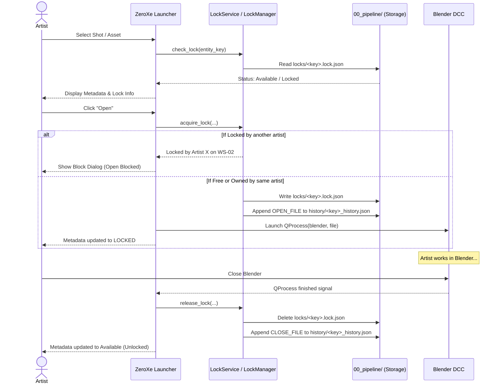

# Pipeline File Locking & Version History System

This document describes the design, directory structure, data schemas, and API reference for the **Cooperative File Locking and Versioning History System** implemented in ZeroXe and the NAS-based Pipeline.

---

## 1. Overview & Architecture

To prevent artists from concurrently overwriting master `.blend` files across shared network storage (`/mnt/...` on Linux or `I:\...` on Windows), ZeroXe uses a **Cooperative Application-Level Lock** paired with an **Append-Only History Audit Trail**.

All system state and audit logs are centralized within the project's **`00_pipeline/`** directory rather than cluttering production working folders:

```text
/mnt/I/20260222_melangkah_dari_timur/
├── 00_pipeline/
│   ├── locks/                                    <-- Active session locks
│   │   └── ep998_sq01_sh0010_anm.lock.json
│   └── history/                                  <-- Permanent audit trail & version log
│       └── ep998_sq01_sh0010_anm_history.json
│
└── 02_production/
    └── 04_animation/
        └── ep998/
            └── ep998_sq01/
                └── ep998_sq01_sh0010/
                    ├── mdt_ep998_sq01_sh0010_anm.blend          <-- Master working file
                    └── progress/
                        ├── mdt_ep998_sq01_sh0010_anm_v001.blend <-- Milestone snapshots
                        └── mdt_ep998_sq01_sh0010_anm_v002.blend
```

---

## 2. Artist Identity Resolution

The locking system tracks identity across four dimensions:

| Field | Source | Purpose |
| :--- | :--- | :--- |
| **`kitsu_id`** | Kitsu / Gazu API (`gazu.client.get_current_user()['id']`) | Globally unique user UUID across production |
| **`name`** | Full name from Kitsu, or email prefix / OS username | Human-readable artist name displayed in UI and dialogs |
| **`email`** | Stored login email | Contact identification |
| **`workstation`** | `socket.gethostname()` / `platform.node()` | Identifies physical machine (e.g. `WS-ANIM-04`) |

---

## 3. Data Schemas

### A. Lock File (`00_pipeline/locks/<entity_key>.lock.json`)

Created when an artist opens a file; deleted when they finish and close Blender:

```json
{
  "entity_key": "ep998_sq01_sh0010_anm",
  "status": "LOCKED",
  "kitsu_id": "3810b978-8a0f-46d7-8ac9-51243507fc3a",
  "name": "Budi Santoso",
  "email": "budi@studio.com",
  "workstation": "WS-ANIM-04",
  "pid": 48192,
  "locked_at": "2026-10-05T09:15:32+07:00",
  "working_file": "02_production/04_animation/ep998/ep998_sq01/ep998_sq01_sh0010/mdt_ep998_sq01_sh0010_anm.blend",
  "current_version": "v002",
  "project": "Melangkah Dari Timur"
}
```

### B. History File (`00_pipeline/history/<entity_key>_history.json`)

Persistent JSON recording all version snapshot milestones and chronological session events:

```json
{
  "meta": {
    "entity_key": "ep998_sq01_sh0010_anm",
    "project": "Melangkah Dari Timur",
    "master_file": "02_production/04_animation/ep998/ep998_sq01/ep998_sq01_sh0010/mdt_ep998_sq01_sh0010_anm.blend",
    "latest_version": "v002",
    "last_updated": "2026-10-05T10:14:00+07:00"
  },
  "versions": [
    {
      "version": "v001",
      "file_path": "02_production/04_animation/ep998/ep998_sq01/ep998_sq01_sh0010/progress/mdt_ep998_sq01_sh0010_anm_v001.blend",
      "kitsu_id": "3810b978-8a0f-46d7-8ac9-51243507fc3a",
      "author": "Budi Santoso",
      "created_at": "2026-10-04T16:45:10+07:00",
      "comment": "Initial keyframe blocking and camera staging.",
      "file_size_mb": 48.2
    },
    {
      "version": "v002",
      "file_path": "02_production/04_animation/ep998/ep998_sq01/ep998_sq01_sh0010/progress/mdt_ep998_sq01_sh0010_anm_v002.blend",
      "kitsu_id": "3810b978-8a0f-46d7-8ac9-51243507fc3a",
      "author": "Budi Santoso",
      "created_at": "2026-10-05T10:14:00+07:00",
      "comment": "Splining character body mechanics.",
      "file_size_mb": 51.7
    }
  ],
  "activity_log": [
    {
      "timestamp": "2026-10-04T14:00:15+07:00",
      "action": "OPEN_FILE",
      "kitsu_id": "3810b978-8a0f-46d7-8ac9-51243507fc3a",
      "user": "Budi Santoso",
      "workstation": "WS-ANIM-04",
      "details": "Opened file mdt_ep998_sq01_sh0010_anm.blend (v001)"
    },
    {
      "timestamp": "2026-10-04T16:45:10+07:00",
      "action": "SAVE_VERSION",
      "kitsu_id": "3810b978-8a0f-46d7-8ac9-51243507fc3a",
      "user": "Budi Santoso",
      "workstation": "WS-ANIM-04",
      "details": "Saved version v001. Initial keyframe blocking."
    },
    {
      "timestamp": "2026-10-04T18:00:00+07:00",
      "action": "CLOSE_FILE",
      "kitsu_id": "3810b978-8a0f-46d7-8ac9-51243507fc3a",
      "user": "Budi Santoso",
      "workstation": "WS-ANIM-04",
      "details": "Released lock on file close"
    },
    {
      "timestamp": "2026-10-05T09:15:32+07:00",
      "action": "OPEN_FILE",
      "kitsu_id": "3810b978-8a0f-46d7-8ac9-51243507fc3a",
      "user": "Budi Santoso",
      "workstation": "WS-ANIM-04",
      "details": "Opened file mdt_ep998_sq01_sh0010_anm.blend (v002)"
    },
    {
      "timestamp": "2026-10-05T10:30:00+07:00",
      "action": "FORCE_UNLOCK",
      "kitsu_id": "lead-uuid-456",
      "user": "Lead Supervisor",
      "workstation": "WS-LEAD-01",
      "details": "Force unlocked by Lead Supervisor. Previous owner: Budi Santoso (Kitsu: 3810b978-8a0f-46d7-8ac9-51243507fc3a, WS: WS-ANIM-04)"
    }
  ]
}
```

---

## 4. Lifecycle & Interaction Workflows



---

## 5. Force Unlock Workflow

If an artist forgets to close Blender, their machine freezes, or they leave the studio:

1. A supervisor/lead selects the locked item in the Launcher.
2. Clicks the **Unlock** (`pushButton_unlock`) button.
3. ZeroXe queries the active lock file and displays a confirmation dialog containing:
   * Current holder's **Name**
   * **Kitsu ID**
   * **Workstation**
   * **Locked Since** timestamp
4. Upon confirmation:
   * `force_unlock()` removes the `.lock.json` file.
   * A `FORCE_UNLOCK` entry is permanently recorded into `00_pipeline/history/` with the supervisor's identity and the previous holder's details.
   * The UI metadata table immediately returns to **Available (Unlocked)**.

---

## 6. Python API Reference

### Pipeline Commands Layer (`pipeline/Commands/main.py`)

```python
from pipeline.Commands.main import (
    acquire_lock,
    check_lock,
    force_unlock,
    get_history,
    record_version,
    release_lock,
)

# 1. Check lock
is_locked, lock_data = check_lock("ep998_sq01_sh0010_anm")

# 2. Acquire lock
success, msg, data = acquire_lock(
    entity_key="ep998_sq01_sh0010_anm",
    kitsu_id="user-uuid-123",
    name="Budi Santoso",
    working_file="02_production/04_animation/.../mdt_anm.blend",
    current_version="v002",
)

# 3. Force unlock
success, msg, prev_holder = force_unlock(
    entity_key="ep998_sq01_sh0010_anm",
    kitsu_id="lead-uuid-456",
    name="Lead Supervisor",
    reason="Artist left for the day",
)

# 4. Record new version snapshot
record_version(
    entity_key="ep998_sq01_sh0010_anm",
    kitsu_id="user-uuid-123",
    name="Budi Santoso",
    version="v003",
    file_path="02_production/04_animation/.../progress/mdt_anm_v003.blend",
    comment="Added facial lip-sync",
)
```

### Application Service Layer (`src/zeroxe/services/lock_service.py`)

```python
from zeroxe.services.lock_service import LockService

# Automatically resolves logged-in Kitsu user or OS environment
user = LockService.get_current_user()
print(user.kitsu_id, user.name, user.workstation)

# Check and acquire
is_locked, data = LockService.check_lock("ep998_sq01_sh0010_anm", project_name="Melangkah Dari Timur")
LockService.acquire_lock("ep998_sq01_sh0010_anm", working_file="...", current_version="v002")
LockService.release_lock("ep998_sq01_sh0010_anm")
LockService.force_unlock("ep998_sq01_sh0010_anm", reason="Lead override")
```

---

## 7. CLI Reference

You can inspect or manage locks directly from the terminal:

```bash
# Check lock status
python pipeline/Commands/main.py lock --key ep998_sq01_sh0010_anm --check

# Acquire lock
python pipeline/Commands/main.py lock --key ep998_sq01_sh0010_anm --kitsu-id "uuid" --name "Budi Santoso"
```
