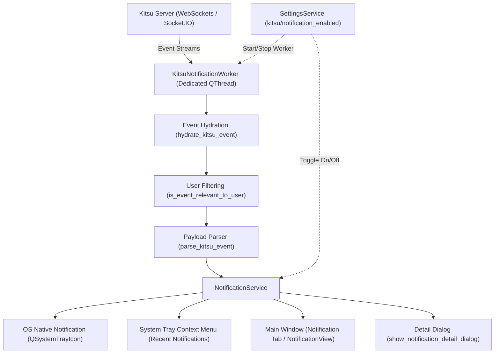

# ZeroXe Notification & Kitsu Real-Time Event System Guide

This guide explains the architecture, background worker, user filtering rules, system tray integration, and settings of the **Notification System** (`src/zeroxe/services/notification_service.py`) in **ZeroXe**.

---

## 1. Overview & Architecture

The ZeroXe Notification System provides native OS desktop alerts and a centralized in-app notification history menu. It listens in real-time to Kitsu Socket.IO / WebSocket events, resolving missing context and filtering out irrelevant notifications.



---

## 2. Key Features

1. **Native OS Notifications**: Displays popups via `QSystemTrayIcon.showMessage()` in the user's OS notification center with application icon branding.
2. **Real-Time Background Listener**: Runs `KitsuNotificationWorker` on a non-blocking background `QThread` using `gazu.events` (Socket.IO).
3. **Smart User Filtering**:
   - **Ignores Self-Actions**: If the current logged-in user posts a comment, changes a status, or creates a task, no self-notification is triggered.
   - **Direct Notifications**: For `notification:new`, only shows events targeted to the current user's ID.
   - **Task Updates & Comments**: Only notifies if the task is assigned to the current user.
4. **Data Hydration**: Kitsu Socket.IO events often carry minimal IDs (`task_id`, `person_id`, `project_id`). The hydrator queries the Gazu API/cache to resolve full project codes, episode names, sequence names, entity names, task types, author names, and status names.
5. **Context Hierarchy Formatting**:
   - Uses **Project Code / Short Name** (e.g. `MDT` instead of full name `MELANGKAH DARI TIMUR`).
   - Resolves and prepends **Episode** (e.g. `ep998`) and **Sequence** (e.g. `sq01`) when available.
   - Intelligent deduplication: avoids repeating sequence/episode prefixes if already embedded in the shot name (e.g., `sq01_sh010`).
   - Prioritizes **Task Type / Department** (e.g. `Lighting`, `Animation`) over internal sub-task stream names (`"main"`).
   - Example Headers:
     - Episodic Shot: `New Comment (MDT | ep998 | sq01 | sh010 | Lighting)`
     - Sequence/Shot: `Task Updated (MDT | ep998 | sq01_sh010 | Lighting)`
     - Asset: `Task Updated (MDT | ep998 | c-hero | Modeling)`
6. **Notification History & UI Tab**:
   - Stores the 50 most recent notifications.
   - Displayed in the dedicated **Notification Tab** (`NotificationView`) powered by `ui_notification.py`.
   - Accessible also from the **System Tray Menu**.
   - Double-clicking or right-clicking any notification opens a detail popup displaying timestamp, sender, and full body.
   - Includes a **`Clear Notifications`** option.

---

## 3. Supported Kitsu Event Types

| Event Identifier | Description | Formatted Output Example |
| :--- | :--- | :--- |
| `comment:new` | A note/comment posted on a task | `New Comment (MDT \| ep998 \| sq01 \| sh010 \| Lighting)`<br>`Jane Doe: Please adjust rim light.` |
| `task:update` | Status change on an assigned task | `Task Updated (MDT \| ep998 \| c-hero \| Modeling)`<br>`Bob Lead changed status to 'Approved'` |
| `notification:new` | Direct in-app Kitsu notification | `Kitsu Notification (MDT \| ep998 \| sq01_sh010 \| Lighting)`<br>`Director Lee: Assigned you to shot.` |
| `task:new` | New task assigned to user | `New Task Assigned (MDT \| ep998 \| sq01 \| sh050 \| Layout)`<br>`Prod Mgr assigned: New task created: Layout` |
| `preview:new` | New preview/version uploaded | `New Preview Uploaded (MDT \| ep998 \| sq01 \| sh010 \| Comp)`<br>`Artist One: New preview (v2) uploaded` |

---

## 4. Configuration & Settings

### In Settings UI
Navigate to **`Edit > Settings > Kitsu`**:
- Check/uncheck **`Notification:`** (`checkBox_notification`).
- Clicking **`Apply`** or **`OK`** immediately starts or stops the background `KitsuNotificationWorker` without restarting the application.

### Settings Persistence
Saved in `QSettings`:
- Key: `kitsu/notification_enabled` (`bool`)

---

## 5. Python API Reference

```python
from zeroxe.services.notification_service import NotificationService

# Initialize tray icon with parent window
NotificationService.initialize(main_window)

# Start real-time background listener
NotificationService.start_kitsu_listener()

# Trigger custom notification
NotificationService.show_notification(
    title="Render Complete",
    message="Frame range 101-200 finished rendering.",
)

# Access history
history = NotificationService.get_notifications()

# Clean shutdown
NotificationService.shutdown()
```
