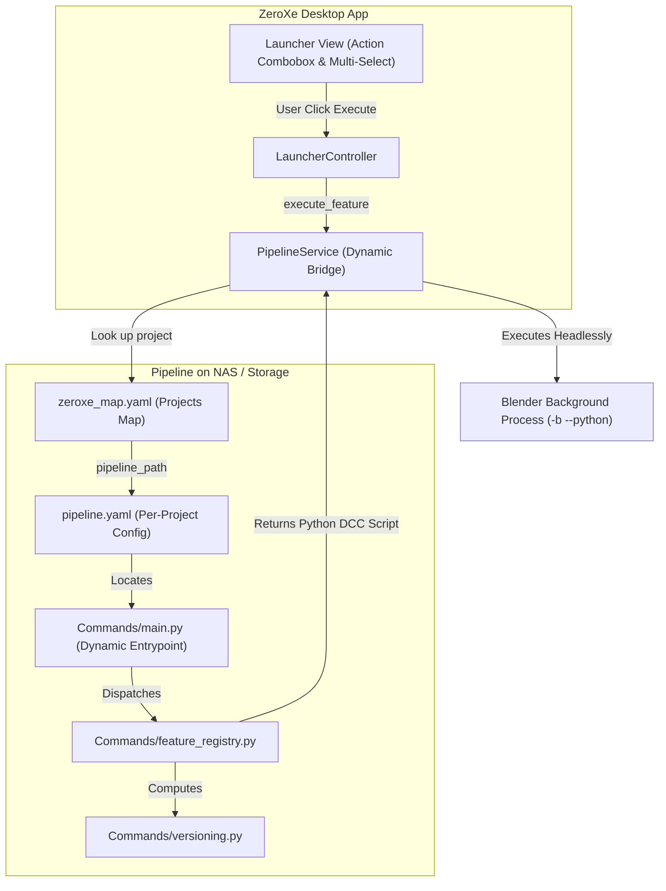

# ZeroXe Pipeline Features & Batch Execution Guide

This document explains the dynamic pipeline feature architecture, the `@register_feature` registry system, per-project scoping via `zeroxe_map.yaml`, and multi-select batch execution in **ZeroXe**.

---

## 1. Architectural Philosophy

The ZeroXe desktop application does **not** hardcode feature definitions, DCC actions, or file incrementation scripts. Instead, all features are **100% pipeline-driven and externalized**.



### Key Principles
1. **Strict Per-Project Isolation**: Features are loaded strictly from the active project configured in `zeroxe_map.yaml`. If a project has no pipeline configuration, the feature dropdown is empty (`None`).
2. **Zero Client Recompilation**: Adding or updating a pipeline feature on your server/NAS takes effect immediately in the desktop application without rebuilding.
3. **Pluggable Architecture**: New actions (e.g. Playblast, Cache Export, Publish) are registered with a simple Python decorator (`@register_feature`).
4. **Batch Execution Support**: Any registered feature automatically supports single execution and batch multi-select execution across multiple shots/assets.

---

## 2. Core Pipeline Features

### A. Up Version (Incremental Versioning)
Incrementally saves the working file to the next version number inside the progress directory.
- **Master file**: `/projects/mdt/02_production/02_layout/ep998/ep998_sq01/ep998_sq01_sh0020/mdt_ep998_sq01_sh0020_lay.blend`
- **Next Version**: `/projects/mdt/02_production/02_layout/ep998/ep998_sq01/ep998_sq01_sh0020/progress/mdt_ep998_sq01_sh0020_lay_v003.blend`
- **Automation script**: Opens the source file, executes `bpy.ops.wm.save_as_mainfile(filepath=..., copy=True)`, and exits Blender.

### B. Up Master (Publish to Master)
Publishes the working version to the master working file and injects optional department preset scripts.
- Resolves the master file path (outside the `progress/` directory).
- Checks `pipeline.yaml` for department preset scripts under `departments.<department>.scripts.up_master`.
- Injects preset script code between file open and final save.

---

## 3. Dynamic Feature Registry (`pipeline/Commands/feature_registry.py`)

All pipeline actions are registered using the `@register_feature` decorator in `feature_registry.py`.

### Registering a New Feature
```python
# pipeline/Commands/feature_registry.py
from Commands.feature_registry import register_feature, PipelineFeatureResult

@register_feature(
    name="Playblast Review",
    description="Generate viewport preview video for client review",
    departments=["animation", "layout"],  # None for all departments
    order=30,
)
def handle_playblast(filepath: str, department: str = None, **kwargs) -> PipelineFeatureResult:
    # Custom python logic or DCC automation script generation
    script = f"""
import bpy
bpy.ops.wm.open_mainfile(filepath="{filepath}")
# Render playblast...
bpy.ops.render.opengl(animation=True)
bpy.ops.wm.quit_blender()
"""
    return PipelineFeatureResult(
        success=True,
        message=f"Playblast queued for {filepath}",
        script=script,
        target_path=filepath,
    )
```

### Parameter Reference for `@register_feature`
| Parameter | Type | Description |
| :--- | :--- | :--- |
| `name` | `str` | Display name in the UI action combobox (e.g. `"Up Version"`, `"Playblast Review"`). |
| `description` | `str` | Short human-readable summary of the feature. |
| `departments` | `Optional[List[str]]` | Filter list of allowed departments (case-insensitive), or `None` for all departments. |
| `order` | `int` | Sort priority in the dropdown list (lower numbers appear first). |

---

## 4. Multi-Select & Batch Execution Workflow

The launcher UI includes a multi-selection mode for executing pipeline actions across multiple shots or assets simultaneously.

### How to Use Multi-Select in the UI
1. Check the **Multi-Select** checkbox (`checkBox_multiSelect`) above the execute button.
2. In the Shot/Asset list (`listView_assetList`), select multiple items using <kbd>Ctrl</kbd> + Click or <kbd>Shift</kbd> + Click.
3. Select your desired feature in the feature dropdown (e.g. `Up Version` or `Up Master`).
4. Click **Execute**:
   - A confirmation dialog displays the count of selected items.
   - ZeroXe iterates sequentially through each item, resolves the latest file path, executes the pipeline script headlessly in Blender, and logs version history.
   - An execution summary dialog reports successes and any individual failures.

```
+-------------------------------------------------------------+
| Batch Up Version Complete                                   |
+-------------------------------------------------------------+
| Successfully processed 3 items:                             |
|  * ep998_sq01_sh0010: .../ep998_sq01_sh0010_lay_v002.blend |
|  * ep998_sq01_sh0020: .../ep998_sq01_sh0020_lay_v002.blend |
|  * ep998_sq01_sh0030: .../ep998_sq01_sh0030_lay_v002.blend |
+-------------------------------------------------------------+
```

---

## 5. Per-Project Scoping & `zeroxe_map.yaml`

Features and pipeline scripts are resolved **strictly per project**:

```yaml
# zeroxe_map.yaml
project:
  MovieProject:
    code: mdt
    name: Movie Project
    pipeline_path: /mnt/nas/projects/mdt/00_pipeline/pipeline.yaml

  CommercialProject:
    code: cmm
    name: Commercial Project
    pipeline_path: /mnt/nas/projects/cmm/00_pipeline/pipeline.yaml
```

- When **MovieProject** is selected in ZeroXe, the app dynamically queries `/mnt/nas/projects/mdt/00_pipeline/Commands/main.py`.
- If a project is selected that has **no** `pipeline_path` entry in `zeroxe_map.yaml`, the feature dropdown automatically displays **nothing** (`None` / empty).
- No fallback to other projects or generic defaults is permitted.

---

## 6. Deploying & Updating Features on Server/NAS

To deploy or update pipeline features for your team:

1. Copy the updated `Commands/` directory to the server's pipeline folder:
   ```
   <Server Pipeline Directory>/
   ├── pipeline.yaml
   └── Commands/
       ├── main.py               # API entrypoint
       ├── feature_registry.py   # Registered features & decorators
       ├── versioning.py         # Version incrementation & master logic
       ├── Paths/                # Path generators
       └── Locks/                # Cooperative locking
   ```
2. Artists running ZeroXe will immediately see new features and updated logic on their next project selection—**no desktop app updates or recompilations required**.

---

## 7. CLI Reference

All pipeline features can also be invoked directly from the terminal or farm render nodes:

### List Features
```bash
python /path/to/pipeline/Commands/main.py list-features --dept Animation --json
```

### Execute Feature
```bash
python /path/to/pipeline/Commands/main.py execute-feature \
  --name "Up Version" \
  --file "/path/to/shot_lay_v001.blend" \
  --dept "Layout" \
  --json
```

### Direct Up Version & Up Master Commands
```bash
# Generate Up Version script
python /path/to/pipeline/Commands/main.py up-version --file "/path/to/shot.blend"

# Generate Up Master script with optional preset
python /path/to/pipeline/Commands/main.py up-master --file "/path/to/shot_v002.blend" --preset "/path/to/bake.py"
```
